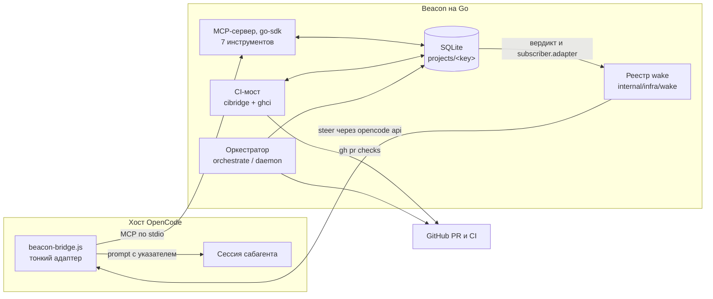
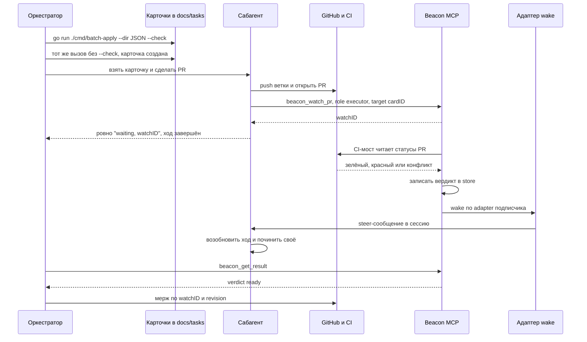
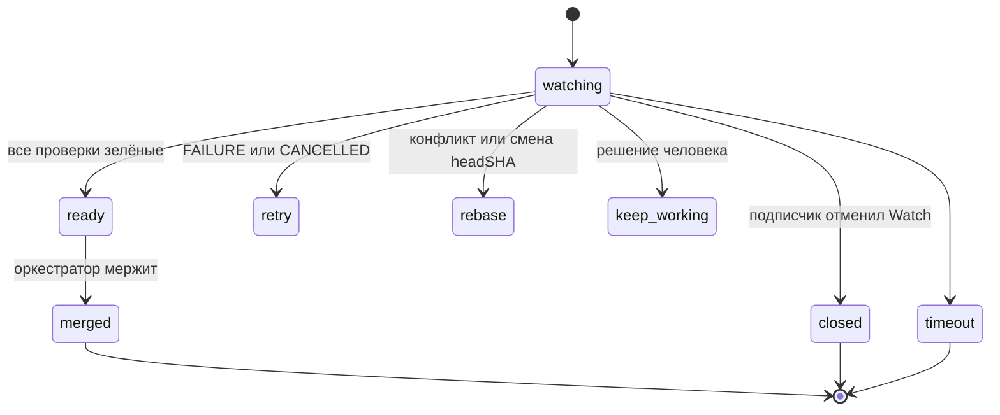

# Beacon

Beacon следит за пулл-реквестами и будит агентов, которые в них работают. Он не запускает проверки и не чинит код. Он хранит список наблюдений, помнит, кто за какой PR отвечает, и решает, когда разбудить агента. Оркестратор получает от Beacon verdict `ready` и только после этого сливает PR.

Без Beacon каждый агент держит свой терминал с `gh ... --watch` и вручную проверяет три вопроса: прошла ли проверка, пора ли будить агента, можно ли сливать. Beacon заменяет эти терминалы одним сервисом. Агент говорит "жду, watchID" и засыпает. Дальше агент ничего не делает, пока не придёт wake.

Масштаб репозитория: больше 600 карточек задач, больше 150 ADR и больше 90 eval-спецификаций. Корпус большой, поэтому новые правила сначала фиксируются в ADR и карточке, а потом попадают в код.

## Из чего состоит Beacon

Один общий MCP-сервер на Go и тонкие плагины-адаптеры. Сервер живёт в `cmd/beacon mcp`, построен на официальном go-sdk и отдаёт ровно семь инструментов. Он не знает имён агентов и не вызывает CLI агентов напрямую. Вся работа с хостом идёт через плагин.

Плагин лежит в `.opencode/plugins/beacon-bridge.js`. Он проектозависим. Корень проекта плагин берёт из `ctx.location.project.canonical`, а не из текущего каталога процесса. Это важно для worktree, где `ctx.location.directory` указывает на каталог worktree, а канонический корень другой. Состояние лежит в `~/.local/state/beacon/projects/<key>`, где `<key>` это имя папки и первые восемь символов SHA-256 абсолютного пути. Два разных проекта в одном сервере OpenCode получают два разных state.

Зачем каждый компонент.

- `MCP-сервер` держит контракт из семи инструментов и не зависит от хоста. Клиент получает правила цикла при handshake. Если внешние порты не переданы, обработчик отвечает ошибкой домена, а не фальшивым успехом.
- `Плагин` подключает сервер к OpenCode и доставляет wake в сессию. Он не считает вердикты и не принимает решения о мерже.
- `Store` на SQLite через `modernc.org/sqlite` хранит Watch, вердикты, ревизии и подписчиков. Миграции лежат в `internal/infra/store/migrations`. Каталог состояния задаётся правилами ADR 0011, явный override это `BEACON_STATE_DIR`.
- `CI-мост` читает статусы PR и переводит Watch в вердикт. Он не запускает проверки и не мержит.
- `Реестр wake` выбирает способ доставки по `subscriber.adapter`. Ядро не знает, какой хост стоит за именем адаптера. Новый получатель добавляется записью в реестр, а не новым ветвлением в ядре.
- `Оркестратор` читает вердикты и выполняет мерж. Он не угадывает причину красного и не разрешает конфликты ребейза.

Семь инструментов MCP: `beacon_watch_pr`, `beacon_wait_result`, `beacon_get_result`, `beacon_list_running`, `beacon_ack`, `beacon_cancel_watch`, `beacon_stats`. Первые три нужны для цикла, `beacon_list_running` и `beacon_stats` только читают состояние, `beacon_cancel_watch` закрывает Watch. Вердикт оркестратор берёт только из `beacon_get_result`.

## Цикл сабагента

Сабагент делает три шага и на этом останавливается. Он не опрашивает `gh pr checks` в цикле и не ждёт вручную.

Отчёт о завершении хода это ровно строка `waiting, watchID`. Любая другая формулировка не считается завершением. `<subagent>`-отчёт со словом `waiting` вердиктом не является. Ревизия меняется только по настоящему событию, поэтому такт `watching` после `watching` не двигает revision и никого не будит.

## Что происходит внутри Beacon

CI-мост живёт в `internal/infra/cibridge` и `internal/infra/ghci`. Провайдер `ghci` читает `gh pr view` и `gh pr checks`. Bridge периодически опрашивает активные Watch и пишет вердикт в store. Отсюда `beacon_get_result` отдаёт `ready` или `retry`. Мост читает GitHub, но не мержит и не перезапускает проверки.

Когда PR становится merged, `cibridge` закрывает Watch. Дальше следить за ним не нужно.

Wake идёт через реестр `internal/infra/wake`. Реестр берёт имя из `subscriber.adapter` и вызывает нужный адаптер. Адаптер `opencode` шлёт steer-сообщение в сессию подписчика через `opencode api`, в тексте стоят настоящие `watchID` и `obligationID`. Неизвестный адаптер это ошибка доставки, а не успех.

Вердикты и переходы:

`keep_working`, `rebase` и `retry` будят подписчика. `ready`, `watching`, `merged`, `closed` и `timeout` не будят. Конфликт ребейза и красный CI чинит подписчик своими правами. Beacon только шлёт wake. У Watch нет жёсткого TTL по времени. Watch закрывается по терминальному вердикту, по отмене или по смене headSHA.

## Оркестратор

У оркестратора три команды и один цикл.

1. `beacon ci check --all` опрашивает все открытые PR и обновляет вердикты.
2. `beacon orchestrate` мержит PR, у которого `verdict=ready`. Мерж идемпотентен по паре `watchID` и `revision`. Повтор с той же парой не создаёт второй мерж. Отчёт агента о простое готовым результатом не считается.
3. `beacon daemon` делает один цикл раз в три минуты: `checkall`, затем `orchestrate`, затем wake по ребейзу. Это не три ручных шага, а один фоновый проход.

Авто-мерж включён по умолчанию. Пустая политика Watch означает мерж по `ready`. Исключения задаются политикой Watch явно, по ADR 0072.

- `requireApproval` запрещает мерж без одобрения.
- `waitFor` перечисляет watchID-зависимости. Каждая должна оказаться в main.
- `waitForMain` требует, чтобы сам watch-PR уже был в main.

Пока условие не выполнено, тулза удерживает мерж и не меняет вердикт. Ребейз тулза не разрешает. При `verdict=rebase` и конфликте она шлёт wake подписавшемуся.

## Команды beacon

Текущие команды: `list`, `task`, `watch`, `spawn`, `attach`, `deliver`, `ci check --all`, `orchestrate`, `daemon`.

| Команда | Что делает |
| --- | --- |
| `beacon list` | Показывает каталог команд |
| `beacon task <list\|new\|take>` | Работает с карточками задач |
| `beacon watch` | Показывает вотчину Beacon с вердиктами и сессиями OpenCode |
| `beacon spawn <taskID>` | Создаёт сессию OpenCode для задачи и отправляет промпт |
| `beacon attach <sessionID>` | Подключается к сессии через фоновый сервис OpenCode |
| `beacon deliver <watchID>` | Доставляет результат по Watch |
| `beacon ci check --all` | Опрашивает все открытые PR |
| `beacon orchestrate` | Мержит по `verdict=ready`, идемпотентно по `watchID` и `revision` |
| `beacon daemon` | Фоновый цикл из трёх шагов каждые три минуты |

Для сборки нужен Go 1.26.0 из пути задания. Команды сборки и ручные прогоны описаны в `AGENTS.md`. Приёмка задачи идёт через CI, а не через локальный прогон.

## Направление, а не сделанное

Две темы исследуются и в код не вошли. Не считайте их работающими.

- Конфиг проектного CI-гейта. Исследуется, как задавать гейт на уровне проекта.
- Webhook-приёмник GitHub. Исследуется приём событий вместо опроса.

Пока эти решения не приняты, источник статусов это опрос PR через `ghci` и `beacon ci check --all`.

## Правила работы

- Локальный `gofmt` не запускается. Форматирование, тесты, гейты и бенчмарки выполняет CI. ADR 0022 фиксирует правило.
- Не мержить красный PR. При красном CI PR возвращается агенту с причиной.
- Не подменять CI локальным прогоном. Локальные evals и e2e это диагностика.
- Не читать вердикт из `<subagent>`-отчёта. Вердикт берётся только через `beacon_get_result`.
- Не трогать чужие файлы и чужие worktree. Один агент, одна ветка, один worktree.
- Карточки создаются и закрываются только через `go run ./cmd/batch-apply`.

## Где подробности

- `docs/adrs/` Архитектурные решения. Начните с 0001 о цели, 0022 о проверке только в CI, 0069 о границе проекта в плагине, 0072 об авто-мерже.
- `docs/tasks/` Карточки от T0.* до T5.*.
- `docs/evals/` Eval-спецификации, больше 90 файлов.
- `evals/README.md` и `tests/e2e/README.md` Как запускать проверки.
- `docs/design/` Проекты и предложения, которые не меняют карточки и ADR.
