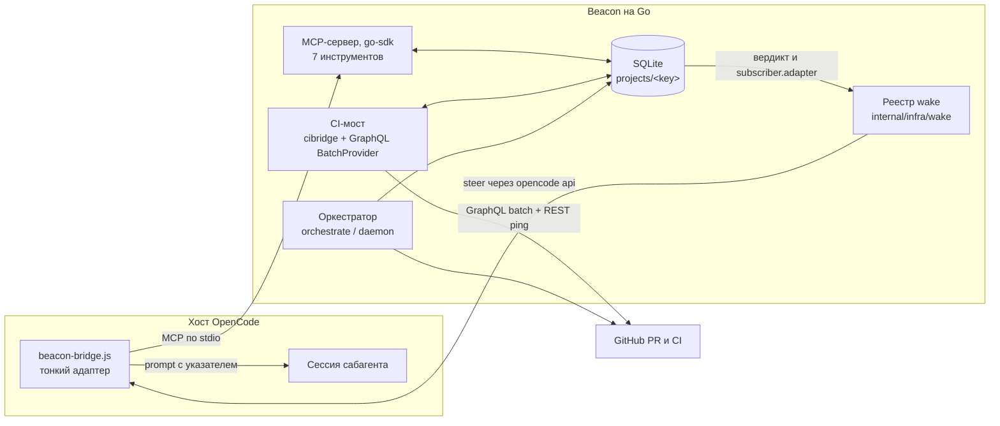
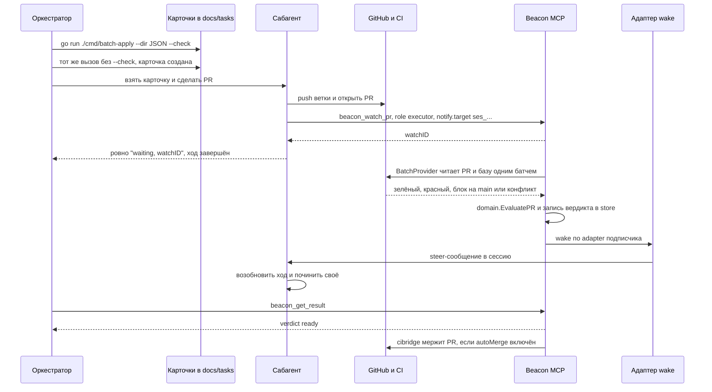
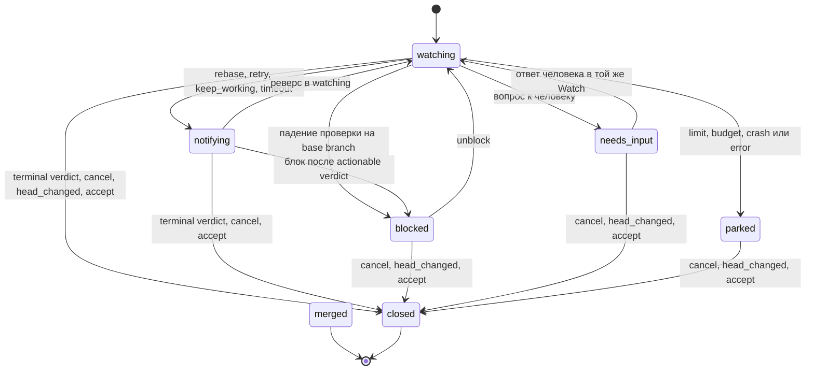

# Beacon

Beacon следит за пулл-реквестами и будит агентов, которые в них работают. Он не запускает проверки и не чинит код. Сервис хранит наблюдения, помнит, кто за какой PR отвечает, и решает, когда разбудить агента. При зелёном CI Beacon сам мержит PR через встроенный адаптер, а оркестратор читает вердикт `ready` из `beacon_get_result`.

Без Beacon каждый агент держит свой терминал с `gh ... --watch` и вручную проверяет три вопроса: прошла ли проверка, пора ли будить агента, можно ли сливать. Beacon заменяет эти терминалы одним сервисом. Агент говорит "жду, watchID" и засыпает. Дальше агент ничего не делает, пока не придёт wake.

Масштаб репозитория: больше 600 карточек задач, больше 150 ADR и больше 90 eval-спецификаций. Новые правила сначала фиксируются в ADR и карточке, а потом попадают в код.

## Из чего состоит Beacon

Один общий MCP-сервер на Go и тонкие плагины-адаптеры. Сервер живёт в `cmd/beacon mcp`, построен на официальном go-sdk и отдаёт ровно семь инструментов. Он не знает имён агентов и не вызывает CLI агентов напрямую. Вся работа с хостом идёт через плагин.

Плагин лежит в `.opencode/plugins/beacon-bridge.js`. Он проектозависим. Корень проекта плагин берёт из `ctx.location.project.canonical`, а не из текущего каталога процесса. Это важно для worktree, где `ctx.location.directory` указывает на каталог worktree, а канонический корень другой. Состояние лежит в `~/.local/state/beacon/projects/<key>`, где `<key>` это имя папки и первые восемь символов SHA-256 абсолютного пути. Два разных проекта в одном сервере OpenCode получают два разных state.

Зачем каждый компонент.

- `MCP-сервер` держит контракт из семи инструментов и не зависит от хоста. Клиент получает правила цикла при handshake через `CycleInstructions`. Если внешние порты не переданы, обработчик отвечает ошибкой домена, а не фальшивым успехом.
- `Плагин` подключает сервер к OpenCode и доставляет wake в сессию. Он не считает вердикты и не принимает решения о мерже.
- `Store` на SQLite через `modernc.org/sqlite` хранит Watch, вердикты, ревизии, подписчиков, обязательства, инциденты блокеров и привязки оркестратора. Миграции лежат в `internal/infra/store/migrations`. Каталог состояния задаётся правилами ADR 0011, явный override это `BEACON_STATE_DIR`.
- `CI-мост` состоит из `internal/infra/cibridge` и `internal/infra/github`. Настоящий провайдер это `github.BatchProvider`: он читает все активные Watch одним GraphQL-батчем, добавляет по одному алиасу на каждую пару `(repo, baseRef)`, чтобы отличить падение уже на main, уточняет ленивое поле `mergeable` через REST и мержит только после свежей проверки mergeability. Мерж подтверждается вторым чтением. Старый провайдер `internal/infra/ghci` читает по одному PR и остаётся запасным путём, когда батч-провайдер не подключён. Мост не запускает проверки. Цикл опроса по умолчанию один раз в 30 секунд. Интервал задаётся переменной `BEACON_CI_POLL_INTERVAL`.
- `Реестр wake` выбирает способ доставки по `subscriber.adapter`. Ядро не знает, какой хост стоит за именем адаптера. Новый получатель добавляется записью в реестр, а не новым ветвлением в ядре.
- `Оркестратор` читает вердикты, разбирает заблокированные Watch, ждёт зависимости по `waitFor` и спавнит FIX-агентов. Авто-мерж живёт в CI-мосте. Команды `beacon orchestrate` и `beacon daemon` остаются контуром управления.

## Семь инструментов MCP

Контракт зафиксирован в `internal/infra/mcp/contract_test.go`. Восьмой инструмент не добавляется без смены контракта.

| Инструмент | Что делает |
| --- | --- |
| `beacon_watch_pr` | Регистрирует или обновляет Watch по `repo`, `pr`, `headSHA`, `role` и `notify`. Возвращает `watchID`, `revision` и `pollAfterMs`. Идемпотентен по псевдониму `(repo, pr, headSHA)` и подписчику. |
| `beacon_wait_result` | Ждёт вердикт на ревизии Watch. Возвращается по событию, по отмене вызова или по уходу сессии вызывающего агента. |
| `beacon_get_result` | Отдаёт вердикт, `failedChecks`, `revision`, `obligationID`, `retryBudget`, а также `nextAction`, `nextCommand` и `nextHint`. Ставит `readAt` на обязательстве. Вердикт берётся только отсюда. |
| `beacon_list_running` | Читает список живых Watch и сессий. Ничего не меняет. |
| `beacon_ack` | Записывает намерение забрать обязательство через `claimedAt`. Принимает `decision`: `approve` или `reject` возобновляют остановленного агента, `blocked:not_mine` блокирует Watch, `blocked:resolved` снимает подтверждённый блок. `continueOf` возвращает ответ человека в ту же припаркованную задачу. |
| `beacon_cancel_watch` | Идемпотентно закрывает Watch. Единственный деструктивный инструмент. |
| `beacon_stats` | Отдаёт счётчики из сохранённого состояния. Ничего не меняет. |

Правила регистрации через `beacon_watch_pr`:

- `repo: "refusedguy/beacon"`, `pr`, `role: "executor"`, `"orchestrator"` или `"fixer"`.
- `notify.target` это настоящий `ses_...` из `_meta["ai.opencode/sessionID"]` или явно заданный `ses_...`. Идентификатор карточки вроде `<BS.42>` отвергается с `INVALID_INPUT`.
- `headSHA` можно не передавать, тогда его прочитает CI-провайдер.
- `fixer` обязан передать `fixFor` с идентификатором Watch в статусе `blocked` и необязательный `fixBlockerID`.
- `orchestratorID` и дескриптор `executor` хранятся как непрозрачные данные. Они не меняют маршрутизацию wake.

Правила цикла приходят в handshake и повторяются здесь.

1. Зарегистрируйте или обновите Watch через `beacon_watch_pr` и сохраните `watchID`.
2. Закончите ход ровно фразой `waiting, watchID`. Не опрашивайте CI в цикле.
3. Просыпайтесь на `keep_working`, `rebase`, `retry`, `blocked` или по готовности. Красные проверки чините своими правами, Beacon только читает CI.
4. Читайте состояние через `beacon_wait_result` и `beacon_get_result`. Отмечайте прочитанное через `beacon_ack`.
5. Оркестратор мержит только после `beacon_get_result` с `verdict=ready`, идемпотентно по паре `(watchID, revision)`. Отчёт сабагента о просто готовым результатом не считается.
6. Закройте законченный или устаревший Watch через `beacon_cancel_watch`. `beacon_list_running` и `beacon_stats` только читают состояние.

Поле `nextAction` из `beacon_get_result` задаёт конкретный шаг, а не произвольный текст.

- `keep_working`: чините только `failedChecks` из ответа, не делайте пустой ребейз неизменённого head.
- `rebase`: выполните `git fetch origin main && git rebase origin/main && git push --force-with-lease`.
- `retry`: выполните `gh run rerun --failed`.
- `blocked`: остановитесь и ждите снятия блока, main не чините.
- `wait`: готового действия нет, закончите ход фразой `waiting, <watchID>`.

В режиме Code Mode инструменты доступны как `tools.beacon.<name>` после `search({ query: "beacon", namespace: "beacon" })`.

## Цикл сабагента

Отчёт о завершении хода это ровно строка `waiting, watchID`. Любая другая формулировка не считается завершением. Ревизия меняется только по настоящему событию, поэтому такт `watching` после `watching` не двигает revision и никого не будит.

## Режимы плана

Карточка задания хранит режим плана в поле `Режим плана`. Значение `fast` или `full`. Пустое поле означает `fast`.

| Режим | Ветка или worktree | Артефакт |
| --- | --- | --- |
| `fast` | исполнитель не создаёт ветку, пишет план в текущем дереве | `PLAN.md` |
| `full` | исполнитель создаёт ветку или worktree по заданию | `PLAN.md` |

Оба режима создают проверяемый артефакт `PLAN.md`. Файл фиксирует шаги и зависимости из карты жизненного цикла в `docs/templates/executor-task.md`. План без `PLAN.md` проваливает карточку по правилу `no-artifact: fail`.

## Вердикты и состояния Watch

`internal/domain/verdict.go` считает вердикт чистой функцией над снимком CI. Правила применяются по порядку, первое совпадение побеждает. `Evaluate` используется для прямой проверки, `EvaluatePR` для рабочего цикла CI. Второй отличается двумя вещами: терминальные состояния не будят никого, а падение проверки уже на main даёт `blocked`, а не запрос executor сделать ребейз.

Вердикты: `watching`, `ready`, `rebase`, `retry`, `keep_working`, `timeout`, `merged`, `closed`, `blocked`. Переходы также используют `needs_input`, `parked` и `accepted`.

`keep_working`, `rebase` и `retry` будят подписчика. При включённом `autoMerge` вердикт `ready` сначала обрабатывается мержем в `cibridge`. Если адаптер мержа не подключён, `ready` будит оркестратора. `watching`, `blocked`, `merged`, `closed`, `needs_input` и `parked` регулярных подписчиков не будят. Ревизия растёт при смене вердикта, включая возврат в `watching`. У Watch нет жёсткого TTL по времени. Watch закрывается по терминальному вердикту, по отмене, по смене headSHA или по успешной команде принятия.

## Блокеры main и FIX-агенты

Если обязательная проверка упала уже на базовой ветке, `EvaluatePR` возвращает `blocked`. Мост переводит Watch в `StatusBlocked`, пишет `BlockedInfo` и создаёт `BlockerIncident` в `BlockerStore`. Инцидент ищется по паре `(repo, baseRef, signature)`, поэтому несколько Watch с одной поломкой main делят одну запись. Оркестратору уходит одно уведомление на инцидент, а не по уведомлению на каждый Watch.

Executor видит внешнюю поломку и отвечает `beacon_ack` с `decision="blocked:not_mine"` и причиной. Оркестратор спавнит FIX-агента с `role: "fixer"` и `fixFor`, равным идентификатору заблокированного Watch. main не чиним. Когда PR FIX-агента мержится, `cibridge` снимает блок с исходного Watch.

`BlockerIncident.MaxFixAttempts` равен трём. После трёх попыток Watch эскалируется к человеку (`ReasonEscalateHuman`). Бюджет хранится на записи инцидента и сбрасывается при снятии блока.

Есть и второй предохранитель. `domain.DefaultMaxWakesPerWatch` равен шести. Счётчик пробуждений живёт в таблице обязательств, поэтому рестарт процесса его не сбрасывает. Когда Watch истратил все шесть wake без зелёного CI, мост паркует его с `ParkReasonBudget` и добавляет одну строку в `ESCALATIONS.md`. Дальше wake по этому Watch не уходят.

## Авто-мерж

`MergePolicy.AutoMerge` включён по умолчанию. Пустая политика Watch означает мерж по `ready`. При `verdict=ready` и включённом `autoMerge` `cibridge` вызывает `github.BatchProvider.MergePRWithState`, используя состояние из того же батча. Если адаптер мержа не подключён, готовый вердикт публикуется и будится оркестратор.

Холд или ошибка мерж превращается в `rebase` при конфликте и в `keep_working` в остальных случаях. Причина пишется в `LastError` подписчика и уходит в wake. Мерж идемпотентен по паре `(watchID, revision)`, повтор с той же парой не создаёт второй мержа.

Исключения политики задаются явно, по ADR 0072.

- `requireApproval` запрещает мерж без одобрения.
- `waitFor` перечисляет идентификаторы зависимостей. Каждая должна оказаться в main.
- `waitForMain` требует, чтобы сам watch-PR уже был в main.

Пока условие не выполнено, тулза удерживает мерж и не меняет вердикт. Ребейз тулза не разрешает.

## Команды beacon

Полный каталог доступен через `beacon list --format json`. Справка по конкретной команде это `beacon what <command>`.

| Команда | Что делает |
| --- | --- |
| `beacon list` | Показывает каталог команд |
| `beacon what <command>` | Объясняет одну команду |
| `beacon doctor`, `beacon build`, `beacon test`, `beacon gates` | Диагностика, сборка, тесты и гейты. Тесты и гейты выполняет CI |
| `beacon task <list\|new\|take>`, `beacon why <task>` | Работает с карточками задач |
| `beacon mcp` | Поднимает MCP-сервер по stdio с реальным store |
| `beacon orchestrate [--dry-run]` | Один проход оркестратора: вердикты, зависимости, wake |
| `beacon orchestrator bind [--session <id>] [--dry-run]` | Привязывает сессию оркестратора проекта и печатает дайджест blocked, orphaned и escalated Watch. Сессия берётся из `--session` или `BEACON_SESSION_ID`. Подкоманда `rebind` устарела |
| `beacon agents`, `beacon workload`, `beacon metrics` | Состояние агентов, нагрузка и метрики |
| `beacon watch [--live] [--interval 2s]` | Таблица Watch и сессий. `--live` подписывается на SSE |
| `beacon spawn <taskID>`, `beacon attach <sessionID>`, `beacon deliver <watchID>` | Создание сессии, подключение и доставка результата по Watch |
| `beacon ci check --all` | Опрашивает открытые PR через CI-провайдер |
| `beacon daemon [--interval] [--once]` | Фоновый цикл. Шаг по умолчанию раз в три минуты |
| `beacon pr create` | Открывает PR по карточке |
| `beacon inspect [<pr\|watchID>] [--json]` | Читает Watch, блокеры, привязку оркестратора, счётчики и журнал эскалаций |
| `beacon logs [--tail N] [--watch id] [--pr n] [--errors] [--json]` | Читает структурированные логи проекта |
| `beacon reset --yes` | Очищает строки control plane проекта. Метаданные, квитанции и реестр агентов сохраняются |

Счётчики состояния доступны через инструмент MCP `beacon_stats`. Отдельной подкоманды `beacon stats` в CLI нет.

Для локальной диагностики используйте `beacon_list_running`, `beacon_stats`, `beacon inspect` и `beacon logs --tail 40 --errors`.

## Живой контур и API

`beacon watch --live` уже работает в коде на `main`. Команда подключается к фоновому сервису OpenCode через тонкий HTTP-клиент. Адрес и пароль берутся из `$XDG_STATE_HOME/opencode/service.json`, авторизация Basic. Подписка идёт на `GET /api/event?types=session.status,session.execution.started`. На каждом событии команда перечитывает снимок Beacon и список сессий через `GET /api/session`, затем печатает таблицу `WATCH | VERDICT | REVISION | SESSION | AGENT | OPENCODE STATE | ATTENTION`. Готовность берётся из вердикта Beacon, а не из `idle` OpenCode. После обрыва SSE клиент переподключается и перечитывает состояние, прошедшие события не проигрываются, потому что поток истории не хранит. Флаг `--interval` задаёт период предохранительного перечитывания, а не замену подписки. Если источник событий не подключён, команда честно падает с ошибкой.

Следующие две темы описаны в ADR как контракт и на `main` ещё не работают. Не считайте их доступными, пока код не влит.

- REST и SSE как равноправный API рядом с MCP (ADR 0106, 0137, 0170). Все доменные сервисы должны быть доступны через REST, MCP и stdio bridge, с одним набором тестов на поведение для всех транспортов. TUI читает готовые проекции `/api/v1` и шлёт команды REST, прямых записей в БД нет (ADR 0191). Пока это предложение, рабочий интерфейс это семь инструментов MCP и команды CLI.
- `beacon human`, человеческий гейт (ADR 0031, раздел 6, и ADR 0041, раздел 1). Контракт: задача ставится на паузу до решения человека, которое приходит как `approve`, `context` или `rework` с возвратом на конкретный шаг лестницы. Пауза освобождает execution slot и не меняет вердикт CI. Пока гейт не влит, паузу даёт состояние `needs_input` с ответом через `beacon_ack` и `continue_of`.

## Направление, а не сделанное

Кроме REST/SSE и `beacon human`, в предложенных ADR остаётся приёмник webhook GitHub (ADR 0149, 0182) и конфиг проектного CI-гейта. Источник статусов на `main` это опрос PR через `BatchProvider` и `beacon ci check --all`.

## Правила работы

- Коммитить и пушить можно только в свою ветку от `origin/main`, работа идёт в worktree и через PR.
- `go test ./...`, `go build ./...` и `beacon gates` локально не запускаются. Их выполняет GitHub Actions на PR. Локально допустим только `gofmt -w` на свои `.go` файлы.
- Не использовать `gh pr checks --watch` и `sleep` в цикле. Ход заканчивается фразой `waiting, <watchID>`.
- Не трогать чужие OwnerFiles и `docs/tasks/`.
- Не запускать `batch-apply` без команды владельца.
- Не мержить красный PR. При красном CI PR возвращается агенту с причиной.
- Не подменять CI локальным прогоном. Локальные evals и e2e это диагностика.
- Не читать вердикт из `<subagent>`-отчёта. Вердикт берётся только через `beacon_get_result`.
- Не трогать чужие файлы и чужие worktree. Один агент, одна ветка, один worktree.
- После обрыва агент продолжает работу в том же worktree. Прочитай `git status`, найди сохранённые правки и продолжи с того шага. Перезапуск с нуля теряет работу и проваливает карточку.

## Где подробности

- `AGENTS.md` Правила агента, приоритетнее старых карточек и ADR.
- `GLOSSARY.md` Словарь домена.
- `docs/adrs/` Архитектурные решения. Начните с 0001 о цели, 0011 о каталоге состояния, 0017 о лестнице пробуждения, 0022 о проверке только в CI, 0060 о живом контуре CLI, 0072 об авто-мерже, 0155 о заблокированном Watch.
- `docs/tasks/` Карточки от T0.* до T5.*.
- `docs/evals/` Eval-спецификации, больше 90 файлов.
- `evals/README.md` и `tests/e2e/README.md` Как запускать проверки.
- `docs/design/` Проекты и предложения, которые не меняют карточки и ADR.
