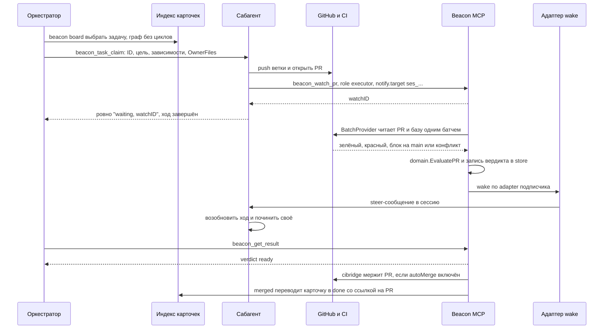
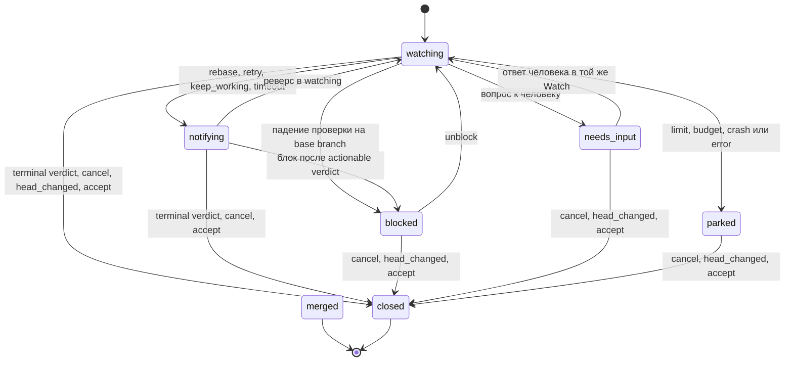

# Beacon

Beacon следит за пулл-реквестами и будит агентов, которые в них работают. Он не запускает проверки и не чинит код. Сервис хранит наблюдения, помнит, кто за какой PR отвечает, и решает, когда разбудить агента. При зелёном CI Beacon сам мержит PR через встроенный адаптер, а оркестратор читает вердикт `ready` из `beacon_get_result`. После мержа Beacon переводит связанную карточку в `done` и пишет ссылку на PR.

Без Beacon каждый агент держит свой терминал с `gh ... --watch` и вручную проверяет три вопроса: прошла ли проверка, пора ли будить агента, можно ли сливать. Beacon заменяет эти терминалы одним сервисом. Агент говорит "жду, watchID" и засыпает. Дальше агент ничего не делает, пока не придёт wake.

Масштаб репозитория: 1146 карточек задач, 305 ADR и 211 eval-спецификаций. Карточки в `docs/tasks/` остаются источником истины, а индекс в state dir пересобирается из них. Новые правила сначала фиксируются в ADR и карточке, а потом попадают в код.

## Из чего состоит Beacon

Один общий MCP-сервер на Go и тонкие плагины-адаптеры. Сервер живёт в `cmd/beacon mcp`, построен на официальном go-sdk и отдаёт ровно девять инструментов. Он не знает имён агентов и не вызывает CLI агентов напрямую. Вся работа с хостом идёт через плагин. Код собирается Go 1.26.0, версия зафиксирована в `go.mod` и проверяется `beacon doctor`. Порог лежит в константе `minGoVersion` (`cmd/beacon/doctor.go:22`), поэтому `go.mod`, документация и проверка ссылаются на одно значение.

Плагин лежит в `.opencode/plugins/beacon-bridge.js`. Он проектозависим. Корень проекта плагин берёт из `ctx.location.project.canonical`, а не из текущего каталога процесса. Это важно для worktree, где `ctx.location.directory` указывает на каталог worktree, а канонический корень другой. Состояние лежит в `~/.local/state/beacon/projects/<key>`, где `<key>` это имя папки и первые восемь символов SHA-256 абсолютного пути. Два разных проекта в одном сервере OpenCode получают два разных state.


Зачем каждый компонент.

- `MCP-сервер` держит контракт из девяти инструментов и не зависит от хоста. Девятый инструмент `beacon_task_claim` зарегистрирован по отдельному ADR. Клиент получает правила цикла при handshake через `CycleInstructions`. Если внешние порты не переданы, обработчик отвечает ошибкой домена, а не фальшивым успехом.
- `Плагин` подключает сервер к OpenCode и доставляет wake в сессию. Он не считает вердикты и не принимает решения о мерже.
- `Store` на SQLite через `modernc.org/sqlite` хранит Watch, вердикты, ревизии, подписчиков, обязательства, инциденты блокеров и привязки оркестратора. Миграции лежат в `internal/infra/store/migrations`. Каталог состояния задаётся правилами ADR 0011, явный override это `BEACON_STATE_DIR`.
- `CI-мост` состоит из `internal/infra/cibridge` и `internal/infra/github`. Настоящий провайдер это `github.BatchProvider`: он читает все активные Watch одним GraphQL-батчем, добавляет по одному алиасу на каждую пару `(repo, baseRef)`, чтобы отличить падение уже на main, уточняет ленивое поле `mergeable` через REST и мержит только после свежей проверки mergeability. Мерж подтверждается вторым чтением. Старый провайдер `internal/infra/ghci` читает по одному PR и остаётся запасным путём, когда батч-провайдер не подключён. Мост не запускает проверки. Цикл опроса по умолчанию один раз в 30 секунд. Интервал задаётся переменной `BEACON_CI_POLL_INTERVAL`.
- `Реестр wake` выбирает способ доставки по `subscriber.adapter`. Ядро не знает, какой хост стоит за именем адаптера. Новый получатель добавляется записью в реестр, а не новым ветвлением в ядре.
- `Оркестратор` читает вердикты, разбирает заблокированные Watch, ждёт зависимости по `waitFor` и спавнит FIX-агентов. Авто-мерж живёт в CI-мосте. Команды `beacon orchestrate` и `beacon daemon` остаются контуром управления.

## Девять инструментов MCP

Контракт зафиксирован в `internal/infra/mcp/contract_test.go`: ровно девять имён, включая `beacon_defer_wiring` из ADR 0094 и `beacon_task_claim` по отдельному ADR.

| Инструмент | Что делает |
| --- | --- |
| `beacon_watch_pr` | Регистрирует или обновляет Watch по `repo`, `pr`, `headSHA`, `role` и `notify`. Возвращает `watchID`, `revision` и `pollAfterMs`. Идемпотентен по псевдониму `(repo, pr, headSHA)` и подписчику. |
| `beacon_wait_result` | Ждёт вердикт на ревизии Watch. Возвращается по событию, по отмене вызова или по уходу сессии вызывающего агента. |
| `beacon_get_result` | Отдаёт вердикт, `failedChecks`, `revision`, `obligationID`, `retryBudget`, а также `nextAction`, `nextCommand` и `nextHint`. Ставит `readAt` на обязательстве. Вердикт берётся только отсюда. |
| `beacon_list_running` | Читает список живых Watch и сессий. Ничего не меняет. |
| `beacon_ack` | Записывает намерение забрать обязательство через `claimedAt`. Принимает `decision`: `approve` или `reject` возобновляют остановленного агента, `blocked:not_mine` блокирует Watch, `blocked:resolved` снимает подтверждённый блок. `continueOf` возвращает ответ человека в ту же припаркованную задачу. |
| `beacon_cancel_watch` | Идемпотентно закрывает Watch. Единственный деструктивный инструмент. |
| `beacon_stats` | Отдаёт счётчики из сохранённого состояния. Ничего не меняет. |
| `beacon_defer_wiring` | Пишет отложенную проводку по `(watchID, reason)`. Возвращает `cardID`, `created`, `status` и текст карточки `WIRING-<pr>`. |
| `beacon_task_claim` | Атомарно выдаёт задачу агенту по `agent ID`. Возвращает ID карточки, цель, зависимости, OwnerFiles, режим плана и handoff, помечает карточку `in_progress` и не даёт второму агенту взять ту же карточку. При готовом индексе ответ содержит `graphReady`. |

Правила регистрации через `beacon_watch_pr`:

- `repo: "refusedguy/beacon"`, `pr`, `role: "executor"`, `"orchestrator"` или `"fixer"`.
- `notify.target` это настоящий `ses_...` из `_meta["ai.opencode/sessionID"]` или явно заданный `ses_...`. Идентификатор карточки вроде `<BS.42>` отвергается с `INVALID_INPUT`.
- `headSHA` можно не передавать, тогда его прочитает CI-провайдер.
- `fixer` обязан передать `fixFor` с идентификатором Watch в статусе `blocked` и необязательный `fixBlockerID`.
- `orchestratorID` и дескриптор `executor` хранятся как непрозрачные данные. Они не меняют маршрутизацию wake.

Правила цикла приходят в handshake и повторяются здесь. Перед циклом оркестратор выдаёт задачу через `beacon_task_claim`: агент получает ID карточки, цель, зависимости и OwnerFiles без поиска по `docs/tasks/`.

1. Зарегистрируйте или обновите Watch через `beacon_watch_pr` и сохраните `watchID`.
2. Закончите ход ровно фразой `waiting, watchID`. Не опрашивайте CI в цикле.
3. Просыпайтесь на `keep_working`, `rebase`, `retry`, `blocked` или по готовности. Красные проверки чините своими правами, Beacon только читает CI.
4. Читайте состояние через `beacon_wait_result` и `beacon_get_result`. Отмечайте прочитанное через `beacon_ack`.
5. Оркестратор мержит только после `beacon_get_result` с `verdict=ready`, идемпотентно по паре `(watchID, revision)`. Отчёт сабагента о просто готовым результатом не считается.
6. Закройте законченный или устаревший Watch через `beacon_cancel_watch`. `beacon_list_running` и `beacon_stats` только читают состояние.

Поле `nextAction` из `beacon_get_result` задаёт конкретный шаг, а не произвольный текст.

- `keep_working`: чините только `failedChecks` из ответа, не делайте пустой ребейз неизменённого head.
- `rebase`: выполните `git fetch origin main && git rebase origin/main && git push --force-with-lease`.
- `retry`: выполните `gh run rerun --failed`.
- `blocked`: остановитесь и ждите снятия блока, main не чините.
- `wait`: готового действия нет, закончите ход фразой `waiting, <watchID>`.

В режиме Code Mode инструменты доступны как `tools.beacon.<name>` после `search({ query: "beacon", namespace: "beacon" })`.

## Таблица соответствий адаптеров

Beacon использует адаптер opencode. Другие harness дают те же шаги под другими именами. Агент читает таблицу один раз за сессию и сопоставляет каждый шаг с тем, что доступно в адаптере.

| шаг | доступен | замена |
| --- | --- | --- |
| Выдача задачи через `beacon_task_claim` | да | тот же вызов MCP |
| Инструменты через Code Mode | да | `tools.beacon.<name>` после `search({ query: "beacon", namespace: "beacon" })` |
| Просмотр карточек в TUI | да | `beacon board`, а без TUI табличный вывод на `tabwriter` |
| Проверка состояния PR в цикле | нет | Watch и `waiting, <watchID>`, вердикт из `beacon_get_result` |
| Встроенный PR-инструмент | нет | `gh pr create` и `gh pr view` в своей ветке |
| Cloud agents и automations | нет | локальный цикл сабагента по Watch |

Для шага, которого нет в адаптере, агент пишет одну строку и продолжает работу.

`Skipped in <adapter>: <step>. <reason>.`

Формат приходит из `pstack/docs/harness/claude-code.md:59-61`. Там строка выглядит как `Skipped in Claude Code: <step>. <reason>.`. В beacon имя адаптера меняется на `opencode`. Пример: `Skipped in opencode: cloud agents. No cloud runner in this harness.`

После строки пропуска агент переходит к следующему шагу. Он не останавливается, не задаёт вопрос владельцу и не повторяет попытку. Причина пропуска записана в той же строке, отдельный отчёт не нужен.

## Цикл сабагента



Отчёт о завершении хода это ровно строка `waiting, watchID`. Любая другая формулировка не считается завершением. Ревизия меняется только по настоящему событию, поэтому такт `watching` после `watching` не двигает revision и никого не будит.

## Индекс карточек и граф зависимостей

Карточки в `docs/tasks/` остаются источником истины. Индекс живёт в state dir и строится из них командой `beacon index build`. CI сверяет индекс побайтово с деревом карточек, а прекоммит блокирует устаревший индекс. Индекс вручную не правят.

Граф строится из четырёх типов рёбер: `blocks`, `depends-on`, `supersedes` и `related`. В граф попадают все семейства ID: T, RS, WIRING и BS. Цикл на записи отвергается. Зависимость, которая замыкает цикл, не добавляют.

Оркестратор выдаёт задачу через `beacon_task_claim`. Второй агент не получит ту же карточку: первая выдача помечает её `in_progress`. Маркер `graphReady` в ответе claim или в `beacon_stats` говорит, что граф собран и актуален.

Связь карточки с Watch и PR хранится в store. При терминальном вердикте `merged` Beacon переводит карточку в `done` и записывает ссылку на PR в подтверждение. Агент карточку не закрывает и статус вручную не меняет.

## beacon board

`beacon board` открывает локальный TUI без сети. Он показывает задачи из индекса, граф зависимостей и фильтры по статусу и владельцу. Для окружений без TUI есть табличный вывод на `tabwriter`. Команда читает тот же индекс, что и MCP-инструменты, и не делает записей в БД.

## Режимы плана

Карточка задания хранит режим плана в поле `Режим плана`. Значение `fast` или `full`. Пустое поле означает `fast`.

| Режим | Ветка или worktree | Артефакт |
| --- | --- | --- |
| `fast` | исполнитель не создаёт ветку, пишет план в текущем дереве | `PLAN.md` |
| `full` | исполнитель создаёт ветку или worktree по заданию | `PLAN.md` |

Оба режима создают проверяемый артефакт `PLAN.md`. Файл фиксирует шаги и зависимости из карты жизненного цикла в `docs/templates/executor-task.md`. План без `PLAN.md` проваливает карточку по правилу `no-artifact: fail`.

## Вердикты и состояния Watch

`internal/domain/verdict.go` считает вердикт чистой функцией над снимком CI. Правила применяются по порядку, первое совпадение побеждает. `Evaluate` используется для прямой проверки, `EvaluatePR` для рабочего цикла CI. Второй отличается двумя вещами: терминальные состояния не будят никого, а падение проверки уже на main даёт `blocked`, а не запрос executor сделать ребейз.

Вердикты: `watching`, `ready`, `rebase`, `retry`, `keep_working`, `timeout`, `merged`, `closed`, `blocked`. Переходы также используют `needs_input`, `parked` и `accepted`. Оркестратор добавляет вердикт `green_blocked`. Проверки зелёные, но открытый блокер удерживает задачу. Задача освобождает слот оркестратора и ждёт снятия блокера. Полное описание лежит в `GLOSSARY.md`, а значение определено в `internal/domain/verdict.go` функцией `EvaluateGreenBlocked`.



`keep_working`, `rebase` и `retry` будят подписчика. При включённом `autoMerge` вердикт `ready` сначала обрабатывается мержем в `cibridge`. Если адаптер мержа не подключён, `ready` будит оркестратора. `watching`, `blocked`, `merged`, `closed`, `needs_input` и `parked` регулярных подписчиков не будят. Ревизия растёт при смене вердикта, включая возврат в `watching`. У Watch нет жёсткого TTL по времени. Watch закрывается по терминальному вердикту, по отмене, по смене headSHA или по успешной команде принятия.

## Блокеры main и FIX-агенты

Если обязательная проверка упала уже на базовой ветке, `EvaluatePR` возвращает `blocked`. Мост переводит Watch в `StatusBlocked`, пишет `BlockedInfo` и создаёт `BlockerIncident` в `BlockerStore`. Инцидент ищется по паре `(repo, baseRef, signature)`, поэтому несколько Watch с одной поломкой main делят одну запись. Оркестратору уходит одно уведомление на инцидент, а не по уведомлению на каждый Watch.

Executor видит внешнюю поломку и отвечает `beacon_ack` с `decision="blocked:not_mine"` и причиной. Оркестратор спавнит FIX-агента с `role: "fixer"` и `fixFor`, равным идентификатору заблокированного Watch. main не чиним. Когда PR FIX-агента мержится, `cibridge` снимает блок с исходного Watch.

`BlockerIncident.MaxFixAttempts` равен трём. После трёх попыток Watch эскалируется к человеку (`ReasonEscalateHuman`). Бюджет хранится на записи инцидента и сбрасывается при снятии блока.

Есть и второй предохранитель. `domain.DefaultMaxWakesPerWatch` равен шести. Счётчик пробуждений живёт в таблице обязательств, поэтому рестарт процесса его не сбрасывает. Когда Watch истратил все шесть wake без зелёного CI, мост паркует его с `ParkReasonBudget` и добавляет одну строку в `ESCALATIONS.md`. Дальше wake по этому Watch не уходят.

## Авто-мерж

`MergePolicy.AutoMerge` включён по умолчанию. Пустая политика Watch означает мерж по `ready`. При `verdict=ready` и включённом `autoMerge` `cibridge` вызывает `github.BatchProvider.MergePRWithState`, используя состояние из того же батча. Если адаптер мержа не подключён, готовый вердикт публикуется и будится оркестратор.

Холд или ошибка мерж превращается в `rebase` при конфликте и в `keep_working` в остальных случаях. Причина пишется в `LastError` подписчика и уходит в wake. Мерж идемпотентен по паре `(watchID, revision)`, повтор с той же парой не создаёт второй мержа.

Исключения политики задаются явно, по ADR 0072.

- `requireApproval` запрещает мерж без одобрения.
- `waitFor` перечисляет идентификаторы зависимостей. Каждая должна оказаться в main.
- `waitForMain` требует, чтобы сам watch-PR уже был в main.

Пока условие не выполнено, тулза удерживает мерж и не меняет вердикт. Ребейз тулза не разрешает.

## Команды beacon

Полный каталог доступен через `beacon list --format json`. Справка по конкретной команде это `beacon what <command>`.

<!-- BEGIN COMMANDS -->
| Команда | Что делает | Использование |
| --- | --- | --- |
| `agents` | Показать агентов OpenCode в режиме subagent или all | `beacon agents [--format table\|json] [--route] [--handoff <taskID>] [--to <sessionID>] [--task <taskID>] [--repo <repo>] [--worktree <dir>]` |
| `attach` | Подключиться к сессии через фоновый сервис OpenCode или возобновить сохранённую сессию | `beacon attach <sessionID> \| beacon attach --resume [<taskID>]` |
| `board` | Показать локальную доску карточек | `beacon board [--root <dir>] [--status <status>] [--owner <owner>]` |
| `build` | Собрать воспроизводимый бинарник beacon | `beacon build` |
| `ci` | Опросить открытые PR через CI-провайдер | `beacon ci check --all` |
| `daemon` | Запустить фоновый цикл оркестратора | `beacon daemon [--interval 0 = адаптивный 10s/30s] [--once]` |
| `deferred` | Показать отложенные wiring-карточки | `beacon deferred [--format table\|json] \| beacon deferred done <watchID>` |
| `deliver` | Доставить результат по Watch в живую сессию | `beacon deliver <watchID>` |
| `doctor` | Проверить версию Go, beacon-gates и каталог состояния или следить за внешним условием | `beacon doctor [--watch] [--interval 2s] [--session <id>] [--max-ticks <n>] [-- <команда>]` |
| `gates` | Передать аргументы бинарнику beacon-gates | `beacon gates [gate] [flags]` |
| `gc` | Очистить завершённые сессии Beacon | `beacon gc [--format table\|json] [--apply]` |
| `gc-worktree` | Очистить устаревшие worktree | `beacon gc-worktree [--format table\|json] [--apply]` |
| `human` | Принять решение оператора по вотче или блокеру | `beacon human [--format table\|json] <approve\|reject\|rework\|unblock\|pause\|resume\|cancel\|context\|force_retry_merge> <watchID\|blockerID> [--note "..."]` |
| `index` | Пересобрать SQLite-индекс карточек | `beacon index build [--root <dir>]` |
| `init` | Подготовить проект: хуки, шаблоны и проверка MCP | `beacon init [--root <dir>] [--force]` |
| `inspect` | Показать состояние вотч, блокеров и привязки оркестратора | `beacon inspect [<pr\|watchID>] [--format table\|json] [--json]` |
| `list` | Показать каталог команд | `beacon list [--format table\|json] [--markdown]` |
| `logs` | Прочитать структурированные логи проекта | `beacon logs [--tail 100] [--watch <id>] [--pr <n>] [--errors] [--format table\|json] [--json]` |
| `mcp` | Запустить MCP-сервер на stdio | `beacon mcp` |
| `metrics` | Показать метрики цикла | `beacon metrics [--format json\|prometheus]` |
| `orchestrate` | Один проход оркестратора: вердикты, зависимости, wake | `beacon orchestrate [--dry-run]` |
| `orchestrator` | Привязать сессию оркестратора проекта | `beacon orchestrator bind [--session <id>] [--dry-run]` |
| `pr` | Открыть PR по карточке | `beacon pr create` |
| `registry` | Управлять реестром сессий проекта | `beacon registry <list\|check\|sync\|stop> [flags]` |
| `regrade` | Пересчитать вердикт по сохранённым доказательствам Watch без повторного прогона | `beacon regrade [--watch <id>] [--dataset <name>] [--split <name>] [--declared <a,b>] [--save <file>] [--format table\|json]` |
| `reset` | Очистить состояние control plane проекта | `beacon reset --yes` |
| `server` | Запустить HTTP-сервер Beacon с лизингом единственного экземпляра | `beacon server` |
| `skills-lock` | Пересчитать или проверить skills-lock.json по снимкам скиллов | `beacon skills-lock [--write \| --check]` |
| `spawn` | Создать сессию OpenCode для задачи Beacon и отправить промпт | `beacon spawn <taskID> [--agent id] [--title ...]` |
| `task` | Работа с карточками задач | `beacon task <list\|new\|take> [flags]` |
| `test` | Запустить тесты проекта через go test ./... | `beacon test` |
| `trace` | Показать журнал wake, ack и retry одной сессии за интервал | `beacon trace --session <id> [--since <duration>] [--format table\|json]` |
| `tui` | Открыть живой экран Beacon | `beacon tui [--root <dir>] [--status <status>] [--owner <owner>]` |
| `up` | Автономный цикл Beacon: ReconcileLoop, статус и команды Telegram | `beacon up [--interval 2s] [--once] [--channels] [--tui]` |
| `watch` | Показать вотчи Beacon с вердиктами и сессиями OpenCode, в живом режиме по событиям SSE | `beacon watch [--interval 2s] [--format table\|json] [--live] [--wake]` |
| `what` | Показать описание одной команды | `beacon what <command>` |
| `why` | Показать цепочку блокировок карточки | `beacon why <task>` |
| `workload` | Показать нагрузку оркестратора | `beacon workload [--format table\|json]` |
<!-- END COMMANDS -->

Счётчики состояния доступны через инструмент MCP `beacon_stats`. Отдельной подкоманды `beacon stats` в CLI нет.

Для локальной диагностики используйте `beacon_list_running`, `beacon_stats`, `beacon inspect` и `beacon logs --tail 40 --errors`.

## Конфигурация: переменные окружения

Beacon читает настройки из окружения через `os.Getenv`. Отдельного файла настроек рантайма нет. Переменная `BEACON_CONFIG` задаёт путь к YAML с политикой Watch, а не к настройкам процесса. Все production-переменные собраны ниже в одном документе. Факты взяты из аудита `docs/research/config-env-audit.md` от 2026-11-21 и сверены с кодом в `cmd/`, `internal/` и `tools/`. Переменная из production-кода, которой нет в таблице, это пробел в документации.

В колонке «по умолчанию» указано значение при пустой переменной. «Валидация» описывает, что код делает с неверным значением. Многие переменные молча подставляют default, поэтому опечатку нельзя заметить в логе. «Где читается» даёт файл и строку. «Риск» это практическое последствие ошибки конфига.

### Пути, состояние и конфиг

| Переменная | По умолчанию | Валидация | Где читается | Риск |
| --- | --- | --- | --- | --- |
| `BEACON_STATE_DIR` | `<XDG_STATE_HOME>/beacon/projects/<name>-<hash>` при `.git` в cwd, иначе `<XDG_STATE_HOME>/beacon` | нет, любая строка становится путём без проверки существования | `cmd/beacon/doctor.go:244,262` | опечатка даёт новый пустой store |
| `XDG_STATE_HOME` | `~/.local/state` | нет, относительный путь остаётся относительным | `cmd/beacon/attach.go:56`, `cmd/beacon/doctor.go:299`, `internal/infra/server/config.go:51` | влияет на каталог состояния |
| `BEACON_PROJECT_ROOT` | `os.Getwd()` | `TrimSpace`, нет проверки что каталог существует | `cmd/beacon/doctor.go:249,269`, `cmd/beacon/mcp.go:1143` | неверное значение меняет ключ проекта и store |
| `BEACON_CONFIG` | `~/.config/beacon/config.yaml` | `TrimSpace`, отсутствующий файл не ошибка | `internal/app/orchestrator/checkall.go:70,152`, `internal/infra/mcp/tool_watch_pr.go:49,99` | опечатка молча даёт дефолтную политику |

### Логи и наблюдаемость

| Переменная | По умолчанию | Валидация | Где читается | Риск |
| --- | --- | --- | --- | --- |
| `BEACON_LOG_FORMAT` | `text` | `NewLogger` сравнивает с `json` без регистра, остальное даёт `text` без предупреждения | `cmd/beacon/observe.go:75,208` | опечатка даёт logfmt вместо JSON |
| `BEACON_LOG_LEVEL` | `info` | `ParseLevel` принимает `debug`, `info`, `warn`, `error`; CLI пишет warning в stderr, `OpenServerLog` молча берёт `info` | `cmd/beacon/observe.go:78,203`, `observe/log.go:33,230` | поведение различается между CLI и server log |
| `BEACON_METRICS_PORT` | пусто, endpoint не открывается | `strconv.Atoi`, bind только на `127.0.0.1`, ошибка в stderr без падения команды | `cmd/beacon/observe.go:99`, `observe/metrics.go:496,512` | `/metrics` просто не поднимется |
| `BEACON_OTEL_ENABLED` | `false` | `EqualFold(TrimSpace(v), "true")`, значение `1` выключено | `observe/otel.go:29,157` | только литерал `true` включает экспорт |
| `BEACON_OTEL_EXPORTER` | пусто, local slog sink | `TrimSpace`, любые значения молча дают local | `observe/otel.go:32,158` | опечатка отключает экспорт без ошибки |
| `OTEL_EXPORTER_OTLP_ENDPOINT` | пусто, local spans | `url.Parse`, нужны scheme и host, схема не ограничена | `observe/otel.go:35,152` | POST уходит на любой адрес |
| `OTEL_EXPORTER_OTLP_TRACES_ENDPOINT` | пусто | та же проверка, перекрывает базовый endpoint | `observe/otel.go:37,153` | тот же канал с более прямым адресом |
| `OTEL_EXPORTER_OTLP_PROTOCOL` | `http/protobuf` | `normalizeProtocol` принимает `http/json`, `json`, `grpc`; `grpc` затем отвергается экспортером и даёт local fallback | `observe/otel.go:40,160` | `grpc` отключает OTLP |

### Каналы и уведомления

| Переменная | По умолчанию | Валидация | Где читается | Риск |
| --- | --- | --- | --- | --- |
| `BEACON_CHANNELS` | `false` | `1/true/yes/on` без регистра, остальное false без предупреждения | `cmd/beacon/server.go:33,57,79-86` | выключенный ingress не защищает слэш-команды |
| `BEACON_CHANNEL_SENDERS` | пусто, ни одного отправителя | строгая запись `sender=actor`; actor проходит `domain.NewActorID`; неверная запись даёт exit 2 | `cmd/beacon/server.go:37,60-75` | единственный источник actor для ingress без документации |
| `BEACON_TELEGRAM_TOKEN` | пусто, sink не настроен | `TrimSpace`, формат токена не проверяется | `wake/telegram.go:22,55` | секрет в env без документации |
| `BEACON_TELEGRAM_CHAT` | пусто | `TrimSpace` | `wake/telegram.go:23,56` | низкий |
| `BEACON_TELEGRAM_API` | `https://api.telegram.org` | `TrimSpace`, `TrimRight("/")`, схема и хост не проверяются | `wake/telegram.go:24,57` | токен в пути запроса уходит на произвольный хост |
| `BEACON_NTFY_URL` | `https://ntfy.sh` | `TrimSpace`, `TrimRight("/")`, схема и хост не проверяются | `wake/ntfy.go:20,23,51,68` | POST с уведомлением уходит на произвольный хост |
| `BEACON_NTFY_TOPIC` | пусто, sink не настроен | `TrimSpace`, формат топика не проверяется | `wake/ntfy.go:21,52,85` | неверный топик молча отключает уведомления |
| `BEACON_GITHUB_TOKEN` | пусто, затем `GITHUB_TOKEN`, затем `gh auth token` | `TrimSpace`, пустое значение молча пропускается | `github/rest.go:38,47`, `mcp/tool_get_result.go:569` | failure excerpt читает только этот токен |
| `GITHUB_TOKEN` | пусто | `TrimSpace` | `github/rest.go:38,47` | fallback в CI, failure excerpt его игнорирует |
| `BEACON_GITHUB_API` | `https://api.github.com` | `TrimSpace`, `TrimRight("/")`, без проверки схемы, хоста и пути | `mcp/tool_get_result.go:573-580` | Bearer-токен уходит на любой хост, переменная не управляет основным GitHub-клиентом |

### HTTP, webhook, сессии и задачи

| Переменная | По умолчанию | Валидация | Где читается | Риск |
| --- | --- | --- | --- | --- |
| `BEACON_HTTP_ADDR` | `127.0.0.1:0` | `net.SplitHostPort`, `Atoi(port)`, хост принудительно `127.0.0.1` | `cmd/beacon/mcp.go:752`, `httpapi/server.go:35,489` | опечатка роняет старт HTTP API |
| `BEACON_WEBHOOK_ADDR` | `127.0.0.1:8788` | хост loopback, порт числовой; ошибка optional receiver не роняет MCP | `cmd/beacon/mcp.go:803`, `webhook/receiver.go:28` | низкий |
| `BEACON_GATES` | пусто, затем `PATH`, затем `tools/beacon-gates/beacon-gates` | `os.Stat`, файл обязан существовать, не быть каталогом и иметь бит исполнения | `cmd/beacon/doctor.go:285-293` | только `doctor`, в проде не читается |
| `BEACON_SESSION_ID` | пусто | `TrimSpace`, формат `ses_` не проверяется | `cmd/beacon/orchestrator.go:25,108`, `daemon.go:219` | неверный ID меняет привязку оркестратора |
| `BEACON_PARENT_SESSION` | пусто | `TrimSpace` | `cmd/beacon/spawn.go:119,164`, `prcreate.go:35,306` | неверная адресация wake или PR-подписчика |
| `BEACON_TASK_ID` | пусто | `TrimSpace`, формат карточки не проверяется | `cmd/beacon/attach.go:274` | низкий |
| `BEACON_TASK_DEADLINE` | пусто | `time.Parse(RFC3339)`, неверное значение молча игнорируется | `cmd/beacon/attach.go:154-159` | дедлайн тихо теряется, запись сохраняется без него |
| `BEACON_AGENT` | пусто | `TrimSpace`, пустое значение без флага даёт exit 1 | `cmd/beacon/task.go:212` | низкий |
| `BEACON_ROOT` | `findProjectRoot()` | `TrimSpace` | `cmd/beacon/task.go:700` | конфликтует с `BEACON_REPO` в скриптах и `BEACON_PROJECT_ROOT` в плагине |

### Демон, MCP и доставка

| Переменная | По умолчанию | Валидация | Где читается | Риск |
| --- | --- | --- | --- | --- |
| `BEACON_DAEMON_INTERVAL` | `3m` | `ParseDuration`, значение больше нуля, неверное молча даёт `3m` | `cmd/beacon/daemon.go:25,219`, `cmd/beacon/mcp.go:60-68` | опечатка меняет цикл демона без предупреждения |
| `BEACON_CI_POLL_INTERVAL` | `30s` | `TrimSpace`, `ParseDuration`, значение больше нуля, неверное даёт `30s` | `internal/infra/cibridge/bridge.go:23-51` | неверное значение возвращает частый опрос и много вызовов `gh` |
| `BEACON_VERDICT_POLL_INTERVAL` | `750ms` | `ParseDuration`, значение больше нуля, неверное молча даёт `750ms` | `cmd/beacon/mcp.go:79,82-86` | меняет свежесть `beacon_wait_result` |
| `BEACON_SYNC_CALL_TIMEOUT` | `30s`, максимум `120s` | `ParseDuration`, значение больше нуля, clamp до `120s`, неверное молча даёт `30s` | `cmd/beacon/mcp.go:213-224` | меняет поведение долгих MCP-вызовов |
| `BEACON_INIT_EVENT` | пусто, precheck не запускается | нет | `cmd/beacon/mcp.go:172` | неверное имя блокирует старт MCP на 10s |
| `BEACON_INIT_BYPASS` | `false` | точный switch `1/true/yes/on` без `TrimSpace` и `ToLower` | `cmd/beacon/mcp.go:173-176` | `TRUE` или ` 1` не срабатывают и дают тихий precheck failure |
| `BEACON_INIT_EVENT_TIMEOUT` | `10s` | `ParseDuration`, значение больше нуля, неверное молча даёт `10s` | `cmd/beacon/mcp.go:177-181` | низкий |
| `BEACON_MCP_REMOTE` | `false` | `1/true/yes/on` с `ToLower` и `TrimSpace`, остальное false | `cmd/beacon/mcp.go:381,384-389` | включает другой набор инструментов без документации |
| `BEACON_PR_PROVIDER` | `github` | `TrimSpace`, enum не проверяется | `prcreate/config.go:11,18` | неизвестный провайдер упадёт позже |
| `BEACON_ACP_RUNNER` | `opencode` | `TrimSpace`, исполняемый файл не проверяется | `cmd/beacon/spawn.go:249,257` | env выбирает исполняемый файл |
| `BEACON_ACP_COMMAND` | пусто, используется runner | `TrimSpace`, полностью заменяет runner, проверки нет | `cmd/beacon/spawn.go:250,263-265` | env выбирает исполняемый файл |
| `BEACON_ACP_ARGS` | пусто | `strings.Fields`, кавычки не интерпретируются | `cmd/beacon/spawn.go:251,266-268` | аргументы с пробелами нельзя передать |
| `BEACON_DELIVER_ADAPTER` | пусто, остаётся installed target | `TrimSpace`, enum здесь не проверяется | `cmd/beacon/deliver.go:318,334` | опечатка молча сохраняет unsupported |
| `BEACON_DELIVER_PI_MODE` | `queue` | `wake.ParsePiDeliveryMode`, только `queue` и `steer`, неверное значение даёт fallback | `cmd/beacon/deliver.go:319,335-340` | низкий |
| `BEACON_DELIVER_PI_TIMEOUT` | `0`, клиентский default | `ParseDuration`, значение больше нуля, неверное даёт fallback | `cmd/beacon/deliver.go:320,341-348` | низкий |

### Имена вне production-рантайма

Следующие имена встречаются в документации и скриптах, но production Go-код их не читает. Оператору не стоит добавлять их в конфиг сервиса.

- `BEACON_REPO` читают только `scripts/verify-beacon.sh` и `scripts/verify-daemon.sh`. Это корень для проверок, а не настройка сервиса. Рядом живут `BEACON_ROOT` в task CLI и `BEACON_PROJECT_ROOT` в плагине. У трёх имён разные default и consumer.
- `BEACON_WAKE_TARGET`, `BEACON_CONTRACT_TEST` и `BEACON_W10A_ACP_MOCK` живут только в тестах. Настоящая цель wake берётся из конфига через `BEACON_CONFIG`.
- `BEACON_HOME`, `BEACON_PERF_WATCHES`, `BEACON_GRAPHQL_URL`, `BEACON_MCP_SRC`, `BEACON_E2E_INSPECTOR` относятся к dropped-карточкам, харнесу eval, perf-скриптам и e2e-тестам.
- `BEACON_ALLOW_MAIN_COMMIT` читает pre-commit hook, который ставит `beacon init`. Значение `1` разрешает коммит в `main` или `master`. Это guard разработчика, а не настройка сервиса.
- `BEACON_PERF_SEED_USED` и `BEACON_PID` живут внутри `tools/perf/measure.sh` и нужны только самому скрипту.
- Переменные `OTEL_SDK_DISABLED`, `OTEL_NOOP_BY_DEFAULT` и другие OTEL-имена из eval-сценариев код сервиса не читает.

Проверить полноту таблицы можно командой из корня репозитория. Она печатает имена `BEACON_*` из production-каталогов, которых нет в `README.md`. Каждый результат должен быть либо добавлен в таблицу, либо отнесён к исключениям выше.

```bash
rg -o --no-filename 'BEACON_[A-Z0-9_]+' cmd internal tools \
  | sort -u \
  | while read -r v; do rg -q "$v" README.md || echo "$v"; done
```

## Живой контур и API

`beacon watch --live` уже работает в коде на `main`. Команда подключается к фоновому сервису OpenCode через тонкий HTTP-клиент. Адрес и пароль берутся из `$XDG_STATE_HOME/opencode/service.json`, авторизация Basic. Подписка идёт на `GET /api/event?types=session.status,session.execution.started`. На каждом событии команда перечитывает снимок Beacon и список сессий через `GET /api/session`, затем печатает таблицу `WATCH | VERDICT | REVISION | SESSION | AGENT | OPENCODE STATE | ATTENTION`. Готовность берётся из вердикта Beacon, а не из `idle` OpenCode. После обрыва SSE клиент переподключается и перечитывает состояние, прошедшие события не проигрываются, потому что поток истории не хранит. Флаг `--interval` задаёт период предохранительного перечитывания, а не замену подписки. Если источник событий не подключён, команда честно падает с ошибкой.

Следующие две темы описаны в ADR как контракт и на `main` ещё не работают. Не считайте их доступными, пока код не влит.

- REST и SSE как равноправный API рядом с MCP (ADR 0106, 0137, 0170). Все доменные сервисы должны быть доступны через REST, MCP и stdio bridge, с одним набором тестов на поведение для всех транспортов. TUI читает готовые проекции `/api/v1` и шлёт команды REST, прямых записей в БД нет (ADR 0191). Пока это предложение, рабочий интерфейс это восемь инструментов MCP и команды CLI.
- `beacon human`, человеческий гейт (ADR 0031, раздел 6, и ADR 0041, раздел 1). Контракт: задача ставится на паузу до решения человека, которое приходит как `approve`, `context` или `rework` с возвратом на конкретный шаг лестницы. Пауза освобождает execution slot и не меняет вердикт CI. Пока гейт не влит, паузу даёт состояние `needs_input` с ответом через `beacon_ack` и `continue_of`.

## Направление, а не сделанное

Кроме REST/SSE и `beacon human`, в предложенных ADR остаётся приёмник webhook GitHub (ADR 0149, 0182) и конфиг проектного CI-гейта. Источник статусов на `main` это опрос PR через `BatchProvider` и `beacon ci check --all`.

## Критерий объёма

Опыт пользователя решает спор между удобством реализации и пользой возможности. Каждая возможность в плане получает три записи: пользователя, проблему, которую она решает, и цену поддержки. Возможность без пользователя и без цены поддержки в план не попадает. При конфликте выбирается опыт пользователя, а не удобство реализации.

Меньшее число отполированных возможностей допускается явно. Это не экономия, а критерий объёма: широкий план с непроверенными возможностями проигрывает узкому плану, у которого каждая возможность обоснована. Поддерживающий инженер считается пользователем первой категории: его опыт входит в число тех, для кого возможность должна облегчать работу, а не утяжелять её.

Источник приёма: `pstack/skills/principle-experience-first/SKILL.md:11-17` (Ship less, ship better). Приём не создаёт новый глобальный скилл и не меняет протокол Watch. Требование к выдаче карточки зафиксировано в `docs/templates/orchestrator-task.md`.

## Функциональные аналоги Harbor-скиллов

Harbor даёт своим навыкам другие имена. ADR 0253 зафиксировал 32 имени Harbor и 64 локальных скилла без точных совпадений. Проверка HD-106 требует в каждой строке аналог или пометку `gaps` и статус.

| Навык Harbor | Локальный аналог | Статус |
| --- | --- | --- |
| `aif-review` | `code-review` проверяет diff и ветку, `pr` готовит тело PR | аналог |
| `aif-fix` | `diagnosing-bugs` находит причину, `tdd` строит фичу от теста | аналог |

Поведение Harbor описано в `docs/tasks/HD-058.md` и `docs/tasks/HD-028.md`. Имена локальных навыков взяты из таблицы скиллов в глобальном `AGENTS.md`. Остальные имена Harbor разбирает HD-105 и eval `docs/evals/hd59-skill-map.md`, где каждая строка получает аналог или `gaps`.

## Правила работы

- Коммитить и пушить можно только в свою ветку от `origin/main`, работа идёт в worktree и через PR.
- `go test ./...`, `go build ./...` и `beacon gates` локально не запускаются. Их выполняет GitHub Actions на PR. Локально допустим только `gofmt -w` на свои `.go` файлы.
- Не использовать `gh pr checks --watch` и `sleep` в цикле. Ход заканчивается фразой `waiting, <watchID>`.
- Не трогать чужие OwnerFiles и чужие карточки. Задачу получать через `beacon_task_claim`, а не искать вручную в `docs/tasks/`.
- Не добавлять зависимости, которые замыкают цикл в графе.
- Не переводить карточку в `done` вручную: это делает Beacon при `merged`.
- Не запускать `batch-apply` без команды владельца.
- Не мержить красный PR. При красном CI PR возвращается агенту с причиной.
- Не подменять CI локальным прогоном. Локальные evals и e2e это диагностика.
- Не читать вердикт из `<subagent>`-отчёта. Вердикт берётся только через `beacon_get_result`.
- Не трогать чужие файлы и чужие worktree. Один агент, одна ветка, один worktree.
- Перед выбором подхода фиксируй в карточке `baseline`: измерение или ссылку на него. Решение без измерения проваливает карточку.
- После обрыва агент продолжает работу в том же worktree. Прочитай `git status`, найди сохранённые правки и продолжи с того шага. Перезапуск с нуля теряет работу и проваливает карточку.

## Где подробности

- `AGENTS.md` Правила агента, приоритетнее старых карточек и ADR.
- `GLOSSARY.md` Словарь домена.
- `docs/adrs/` Архитектурные решения. Начните с 0001 о цели, 0011 о каталоге состояния, 0017 о лестнице пробуждения, 0022 о проверке только в CI, 0060 о живом контуре CLI, 0072 об авто-мерже, 0155 о заблокированном Watch.
- `docs/tasks/` Карточки от T0.* до T5.*, источник истины. Индекс и `beacon board` это другие пути к тем же данным.
- `docs/evals/` Eval-спецификации, больше 90 файлов.
- `evals/README.md` и `tests/e2e/README.md` Как запускать проверки.
- `docs/design/` Проекты и предложения, которые не меняют карточки и ADR.
